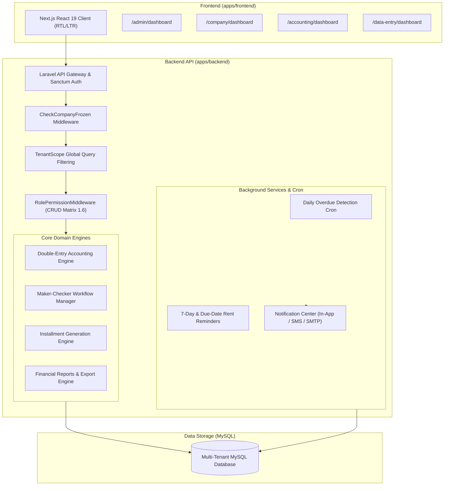

# Technical Architecture Specification (ARCHITECTURE-SPINE.md)
## Cloud Accounting & Operational ERP System (Mohamed Ramadan Group v1.0)
**Source Baseline**: `docs/SRS.md` (Sole and Final Source of Truth)

---

## 1. System Overview & Architectural Topology

The system is architected as a decoupled, modern multi-tenant enterprise ERP comprising:
1. **Frontend**: Next.js (React 19) Single Page / App Router architecture in `apps/frontend/`, delivering native Right-to-Left (RTL) Arabic as the primary language and Left-to-Right (LTR) English as secondary, styled with Tailwind CSS and Lucide Icons.
2. **Backend**: PHP Laravel 11/12 RESTful API engine in `apps/backend/`, enforcing strict tenant isolation, role-based access control (RBAC), Maker-Checker workflows, double-entry balanced accounting engine, and background cron schedules.
3. **Database & Storage**: MySQL relational engine (with in-memory SQLite support for automated CI test suites) with strict foreign keys and transactional guarantees (`DB::transaction`).

---

## 2. Architectural Decisions (ADs)

### AD-01: Logical Multi-Tenancy via Global Tenant Scoping & Immediate Frozen Revocation
- **Binds**: Every database query on tenants, accounts, cost centers, properties, units, contracts, vouchers, invoices, and journals.
- **Prevents**: Cross-tenant data leakage and unauthorized access during company account suspension.
- **Rule**:
  1. All company-specific database tables include a mandatory indexed `company_id` foreign key.
  2. Eloquent models apply a global query scope `TenantScope` that automatically appends `where('company_id', $currentCompanyId)` unless the authenticated actor is `Super Admin`.
  3. `CheckCompanyFrozen` middleware executes on every incoming authenticated request. If the user's bound company has `status === 'frozen'`, the request is immediately rejected with HTTP 403 (`حساب الشركة مجمد حالياً` / `Company account is currently frozen`), and current Sanctum tokens are revoked.

### AD-02: Exact RBAC Enforcement per Section 1.6 CRUD Matrix
- **Binds**: All API endpoints and UI action buttons.
- **Prevents**: Privilege escalation and unauthorized role mutations.
- **Rule**:
  - Permissions are mapped strictly per Section 1.6 of `docs/SRS.md` across 6 actors (`Super Admin`, `Branch Manager`, `General Accountant`, `Data Entry`, `Tenant`, `SMS Gateway`).
  - Data Entry role cannot approve vouchers, close fiscal years, or edit locked records.
  - General Accountant role cannot freeze companies or override system global configs.

### AD-03: Fixed Root Chart of Accounts Inheritance & Strict Double-Entry Engine
- **Binds**: Chart of Accounts creation, Voucher approvals, and Manual Journal Entries.
- **Prevents**: Unbalanced financial books, orphan ledger lines, and inconsistent account classifications.
- **Rule**:
  1. When a new company tenant is provisioned, the system auto-seeds the fixed 5 root classes: `1` Assets, `2` Liabilities, `3` Equity, `4` Revenue, `5` Expenses.
  2. Every Journal Entry consists of at least two `journal_entry_lines`. The entry is mathematically valid if and only if:
     $$\sum \text{Debit} - \sum \text{Credit} = 0.00$$
  3. Journal entries are strictly immutable once posted (`status === 'posted'`). Modification is prohibited; corrections must be executed via counter-reversing entries (`is_reversal = true`).

### AD-04: Mandatory Cost Center Linking & Per-Building Income Statements
- **Binds**: Property creation, Unit creation, Voucher expense/revenue line items, and Progress billings.
- **Prevents**: Operational expenses without organizational or asset attribution.
- **Rule**:
  1. Creating a Real Estate Property automatically provisions a parent Cost Center (`PROPERTIES / [Property Name]`).
  2. Creating a Property Unit automatically provisions a child Cost Center under the property (`[Property Cost Center] / Unit [Unit Number]`).
  3. Every transaction against Revenue (Class 4) or Expense (Class 5) accounts requires a valid `cost_center_id`.
  4. Building Income Statement filters ledger lines by the property's cost center tree to compute true net operating profit per building:
     $$\text{Building Net Profit} = \sum \text{Revenues}_{\text{CostCenter}} - \sum \text{Expenses}_{\text{CostCenter}}$$

### AD-05: Maker-Checker Four-Eyes Principle for Vouchers and Contractor Invoices
- **Binds**: Receipt Vouchers, Disbursement Vouchers, and Contractor Invoices.
- **Prevents**: Internal fraud, unauthorized disbursements, and unvetted supplier claims.
- **Rule**:
  1. Initial creation creates records in `draft` status.
  2. A `draft` voucher does NOT generate or post any General Ledger journal entry.
  3. Approving a voucher transitions status to `approved`, creates a balanced Journal Entry, and posts it to the General Ledger within an atomic database transaction (`DB::transaction`).
  4. Rejecting a voucher requires a mandatory `rejection_reason` string with length $\ge 10$ characters (`rejection_reason.min:10`). Transitions state to `rejected` and dispatches in-app alerts to the creator.

### AD-06: Automated Installment Schedule Generation Engine
- **Binds**: Lease contract activation (`UC-34`, `UC-35`, `UC-38`).
- **Prevents**: Manual arithmetic errors and misaligned installment dates.
- **Rule**:
  - Upon contract activation (`status === 'active'`), the system computes exact installments:
    - Monthly: 12 installments, due every 1 calendar month.
    - Quarterly: 4 installments, due every 3 calendar months.
    - Semi-Annual: 2 installments, due every 6 calendar months.
    - Annual: 1 installment, due on contract start date.
  - Sum of installment amounts equals contract total annual rent. Status initialized to `pending`.

### AD-07: Background Scheduled Tasks & Event-Driven Notifications
- **Binds**: Rent reminders, overdue status transition, and transactional notifications.
- **Prevents**: Missed rent collections and stale operational statuses.
- **Rule**:
  1. Daily scheduled command `php artisan erp:check-overdue-installments`:
     - Checks all `pending` installments where `due_date < today`.
     - Transitions status to `overdue`.
     - Dispatches SMS & in-app notification to tenant and General Accountant (`UC-41A`).
  2. Daily scheduled command `php artisan erp:send-rent-reminders`:
     - 7-day alert: `due_date = today + 7 days`.
     - Due-date alert: `due_date = today`.
  3. Notification Center registers events into `notifications` table for real-time badge counts.

### AD-08: Financial Reporting & Export Engine (PDF / Excel)
- **Binds**: Trial Balance, General Ledger, Balance Sheet, Income Statement, Building P&L (`UC-61` to `UC-66`).
- **Prevents**: Inconsistent financial statements and untraceable balances.
- **Rule**:
  - All report queries leverage direct indexed aggregation on `journal_entry_lines` and `accounts`.
  - Excel exports stream via PhpSpreadsheet / FastExcel generating native `.xlsx` files with standard tabular formatting.
  - PDF exports format with RTL Arabic CSS support and official corporate letterhead.

### AD-09: Irreversible Fiscal Year Closing
- **Binds**: Fiscal year closing workflow (`UC-67`, `UC-68`).
- **Prevents**: Backdated postings into closed financial periods.
- **Rule**:
  - Closing requires pre-flight verification: zero unposted vouchers and zero draft journal entries in the fiscal period.
  - System generates an automatic Closing Journal Entry: transfers net income (Total Revenue - Total Expense) into Retained Earnings (`300001`), zeroing out nominal accounts.
  - Updates `fiscal_years.status` to `closed`. Subsequent postings to dates within a closed fiscal year are strictly rejected by the posting engine.

### AD-10: Decoupled Frontend (Next.js) & Backend (Laravel) Architecture
- **Binds**: Repository directory layout and runtime communication.
- **Prevents**: Monolithic coupling and rigid hosting restrictions.
- **Rule**:
  - `apps/backend/`: Laravel 11/12 API backend providing JSON endpoints (`/api/v1/...`).
  - `apps/frontend/`: Next.js frontend consuming Laravel API via Axios client with Bearer Token interceptor.
  - Native RTL directionality handled via HTML document attribute `dir="rtl"` and Tailwind CSS RTL logical classes.

