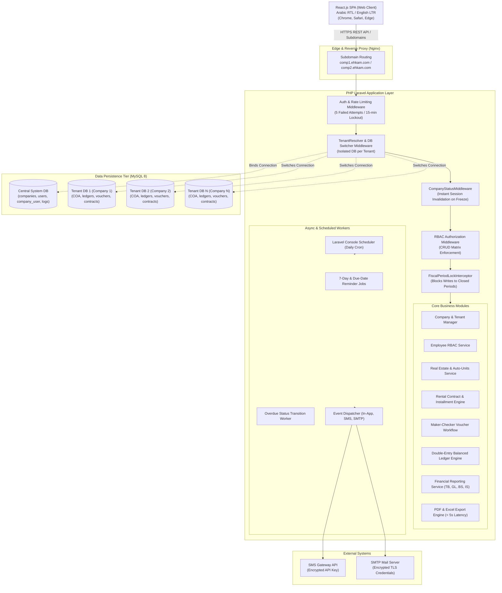

# Technical Architecture Spine (ARCHITECTURE-SPINE.md)
## Cloud Accounting & Operational ERP System (Mohamed Ramadan Group)

---

## 1. Executive Architecture Summary & Core Invariants

The **Cloud Accounting & Operational ERP System** is architected as an enterprise-grade **Multi-Tenant Modular Monolith**. It pairs a high-performance **PHP Laravel 11** backend engine with a responsive, component-driven **React 18** Single Page Application (SPA), orchestrated across a multi-database **MySQL 8** infrastructure.

### The Invariants (Durable Architectural Decisions)
1. **Isolated Multi-Tenancy (AD-01)**: Every company entity operates in a physically separated MySQL database (`tenant_{uuid}_db`). No tenant application query ever joins across tenant databases.
2. **Instant Force-Eviction on Freeze (AD-02)**: When a company is frozen by the Super Admin, the company's session epoch is incremented in the central store, immediately invalidating all active JWT tokens/sessions for all users belonging to that company. Subsequent requests are rejected with HTTP 403.
3. **Strict CRUD RBAC Middleware (AD-03)**: Every API route is guarded by role-based middleware that strictly implements the Section 1.6 permission matrix.
4. **Permanent Root COA & Recursive Nature Inheritance (AD-04)**: Fixed root accounts (Assets, Liabilities, Equity, Expenses, Revenues, Sales, Purchases, Returns, Discounts, Withdrawals) cannot be altered or deleted. Sub-accounts recursively inherit their parent's nature (Debit or Credit).
5. **Period Lock Pre-Flight Guard (AD-05)**: No transaction, voucher, or journal entry can be created, edited, approved, or posted inside a closed fiscal period.
6. **Mandatory Cost Center Constraint (AD-06)**: Accounts flagged as requiring cost centers reject journal entry creation unless valid cost center IDs are attached.
7. **Maker-Checker Financial Separation (AD-07)**: Data Entry has write access only to Draft states; the General Accountant holds exclusive write access to Approve/Reject states.
8. **Balanced Journal Entry Immutability (AD-08)**: Posting enforces $\sum \text{Debit} - \sum \text{Credit} = 0$. Posted entries are strictly immutable (read-only); corrections require an explicit offsetting Reversal Entry.

---

## 2. High-Level System Architecture Diagram



---

## 3. Architecture Decisions (ADs)

### AD-01: Multi-Tenant Architecture & Dynamic Database Switching
- **Status**: `[ADOPTED]`
- **Binds**: Backend Database Configuration & Middleware Pipeline.
- **Prevents**: Cross-tenant data leaks, accidental cross-company queries, commingled balances.
- **Rule**:
  1. The system maintains two database connections in `config/database.php`: `central` (default system DB) and `tenant` (dynamically configured per request).
  2. The `TenantResolverMiddleware` extracts the tenant identifier from:
     - Subdomain header (e.g. `comp1.ehkam.com` $\rightarrow$ `comp1`).
     - Or authenticated user session/JWT claims `company_id`.
  3. The middleware resolves tenant database credentials from `central.companies`, updates `config(['database.connections.tenant.database' => $db_name])`, purges the existing `tenant` connection, and sets `DB::setDefaultConnection('tenant')`.
  4. Super Admin consolidated queries programmatically iterate over active company databases via `DB::connection('tenant')` and aggregate metrics in memory without executing multi-database raw SQL joins.

### AD-02: Frozen Company Token Invalidation & Immediate Eviction
- **Status**: `[ADOPTED]`
- **Binds**: Authentication, Session Management, Super Admin Freeze API.
- **Prevents**: Unauthorized employee operations after an entity is suspended.
- **Rule**:
  1. The central `companies` table contains a column: `session_epoch INT DEFAULT 1`.
  2. Upon login, the user's JWT payload embeds `company_epoch`.
  3. When the Super Admin invokes `POST /api/admin/companies/{id}/freeze`, the system sets `companies.status = 'frozen'` and executes `companies.session_epoch = session_epoch + 1`.
  4. The `CompanyStatusMiddleware` checks the company status on every incoming request. If `status === 'frozen'`, or if the JWT token's `company_epoch < current_session_epoch`, the request is rejected immediately with HTTP 403 Forbidden: `{"message": "الشركة مجمدة، تم إنهاء الجلسة فوراً"}`.

### AD-03: RBAC Authorization Matrix Enforcement
- **Status**: `[ADOPTED]`
- **Binds**: API Routes and Frontend Navigation.
- **Prevents**: Privilege escalation and unauthorized CRUD operations.
- **Rule**:
  1. User roles are strictly: `super_admin`, `branch_manager`, `general_accountant`, `data_entry`.
  2. A dedicated middleware `AuthorizePermission:module,action` checks the authenticated user's role against the Section 1.6 matrix:
     - `data_entry` requesting `POST /api/vouchers` $\rightarrow$ Allowed (Creates Draft).
     - `data_entry` requesting `POST /api/vouchers/{id}/approve` $\rightarrow$ Blocked (HTTP 403).
     - `branch_manager` requesting `POST /api/contracts/{id}/cancel/approve` $\rightarrow$ Allowed.
     - `general_accountant` requesting `POST /api/vouchers/{id}/approve` $\rightarrow$ Allowed.

### AD-04: Chart of Accounts & Recursive Nature Inheritance
- **Status**: `[ADOPTED]`
- **Binds**: Financial Ledger & Account Models.
- **Prevents**: Accounting classification errors, inverted trial balance totals.
- **Rule**:
  1. Each tenant database seeds 12 immutable root accounts:
     - Assets (1000 - Debit), Liabilities (2000 - Credit), Equity (3000 - Credit), Expenses (4000 - Debit), Revenues (5000 - Credit), Purchases (6000 - Debit), Sales (7000 - Credit), Purchase Returns (8000 - Credit), Sales Returns (9000 - Debit), Withdrawals (3100 - Debit), Discounts Allowed (4100 - Debit), Discounts Earned (5100 - Credit).
  2. The `Account` model uses a parent-child adjacency list (`parent_id`).
  3. When creating a child account, `nature` is automatically locked to `parent.nature`.
  4. An account cannot be deleted if child accounts exist or if `journal_entry_items` reference it.

### AD-05: Fiscal Period Locking & Pre-Flight Interceptor
- **Status**: `[ADOPTED]`
- **Binds**: All write operations touching General Ledger or Vouchers.
- **Prevents**: Retroactive adjustments to audited closed fiscal periods.
- **Rule**:
  1. The `CheckFiscalPeriodOpen` middleware/service intercepts any write request carrying a transaction date (`date`).
  2. Queries `fiscal_periods` where `$date BETWEEN start_date AND end_date`.
  3. If no period covers the date, or if `period.status === 'closed'` or `fiscal_year.status === 'closed'`, the operation aborts with HTTP 422: `{"message": "لا يمكن إنشاء أو ترحيل قيود في فترة مالية مغلقة"}`.

### AD-06: Mandatory Cost Center Linking Validator
- **Status**: `[ADOPTED]`
- **Binds**: Manual Journal Entries, Vouchers, Invoices.
- **Prevents**: Unassigned expenses/revenues preventing per-building P&L analysis.
- **Rule**:
  1. `accounts.is_cost_center_mandatory BOOLEAN`.
  2. When persisting any journal entry item, if `account.is_cost_center_mandatory === true` and `item.cost_center_id === null`, validation throws HTTP 422: `{"message": "يجب تحديد مركز التكلفة لهذا الحساب"}`.

### AD-07: Property Provisioning & Automatic Multi-Object Sync
- **Status**: `[ADOPTED]`
- **Binds**: Real Estate Module & Cost Centers.
- **Prevents**: Decoupled buildings and missing cost tracking units.
- **Rule**:
  1. In `PropertyService::createProperty($data)`:
     - Wrap in a DB transaction.
     - Insert `properties` record.
     - Insert `cost_centers` record with `name = $property->name` and `type = 'property'`.
     - Update `$property->update(['cost_center_id' => $cost_center->id])`.
     - Loop $1 \dots N$ (where $N = \text{units\_count}$): insert `units` with `status = 'vacant'`.

### AD-08: Automated Rental Contract Installment Generator
- **Status**: `[ADOPTED]`
- **Binds**: Rental Contract Creation (`RentalContractService`).
- **Prevents**: Incorrect due dates, manual installment calculation errors.
- **Rule**:
  1. Supported cycles: `monthly` (12 installments), `quarterly` (4 installments), `semi_annual` (2 installments), `annual` (1 installment).
  2. Number of installments $M = \text{Duration (Years)} \times \text{Cycle Multiplier}$.
  3. Base installment amount $= (\text{Total Rent} - \text{First Payment}) / (M - 1)$ (or equal division if no first payment).
  4. In a DB transaction:
     - Create `rental_contracts` in status `active`.
     - Update unit status to `occupied`.
     - Insert $M$ `installments` records with computed due dates and status `due`.

### AD-09: Maker-Checker Voucher Workflow Engine
- **Status**: `[ADOPTED]`
- **Binds**: Financial Vouchers (`VoucherService`).
- **Prevents**: Premature ledger posting without financial approval.
- **Rule**:
  1. Data Entry creates voucher: Status set to `draft`. No ledger impact. Emits `VoucherDraftCreated` event.
  2. General Accountant reviews voucher:
     - **Approval**: Sets status to `approved`. Dispatches `AutoPostJournalEntryJob`.
     - **Rejection**: Requires `rejection_reason` ($\ge 10$ chars). Sets status to `rejected`. Emits `VoucherRejected` event with reason.
  3. Data Entry modifies rejected voucher: Resubmits $\rightarrow$ resets status to `draft`.

### AD-10: Automated Balanced Journal Entry Engine & Ledger Immutability
- **Status**: `[ADOPTED]`
- **Binds**: General Ledger Posting (`LedgerService`).
- **Prevents**: Unbalanced entries, ledger tampering.
- **Rule**:
  1. Entry posting verification:
     $$\sum_{i} \text{Debit}_i - \sum_{i} \text{Credit}_i == 0.0000$$
     If non-zero, rollback transaction and throw exception: *"القيد غير متوازن، يرجى مراجعة البنود"*.
  2. On successful posting: Status set to `posted`.
  3. Posted records lock database row: Any `UPDATE` or `DELETE` attempt on `journal_entries` or `journal_entry_items` where `status = 'posted'` is blocked by an Eloquent model hook and MySQL database trigger.
  4. Counter-Account logic:
     - If an entry has exactly 1 debit and 1 credit row, each row's `counter_account_id` references the other.
     - If an entry has multiple opposing rows, `counter_account_name` is set to *"المذكورين"*.

### AD-11: Financial Reports Calculation Services
- **Status**: `[ADOPTED]`
- **Binds**: `FinancialReportService`.
- **Prevents**: Discrepancies between reports and ledger.
- **Rule**:
  1. **Trial Balance**:
     - $\text{Period Debit} = \sum \text{debits in date range}$.
     - $\text{Period Credit} = \sum \text{credits in date range}$.
     - Balance condition strictly verified: $\sum \text{Ending Debit} - \sum \text{Ending Credit} = 0$.
  2. **General Ledger**:
     - Computes running balance row by row according to account nature.
  3. **Balance Sheet**:
     - $\text{Assets} = \text{Liabilities} + \text{Equity}$.
     - Equity includes Net Profit computed dynamically from Income Statement minus Withdrawals.
  4. **Per-Building Income Statement**:
     - Filters ledger rows by `cost_center_id` for revenue and direct expense accounts.

### AD-12: High-Performance PDF & Streaming Excel Export
- **Status**: `[ADOPTED]`
- **Binds**: Reporting Controller & Export Pipelines.
- **Prevents**: HTTP timeout on large ledger exports.
- **Rule**:
  1. PDF exports use `barryvdh/laravel-dompdf` or headless Chrome wrapper with optimized RTL CSS `@media print` rules.
  2. Excel exports use `maatwebsite/excel` streaming writer (`FromQuery` with chunking) to generate `.xlsx` with $< 5$ sec response latency.

### AD-13: Scheduled Background Jobs & Multi-Channel Alert Pipeline
- **Status**: `[ADOPTED]`
- **Binds**: Laravel Console Scheduler & Queue Workers.
- **Prevents**: Missed rent notifications and manual status transitions.
- **Rule**:
  1. Registered in `app/Console/Kernel.php`:
     - `08:00 daily`: `SendPreDueRentRemindersJob` (7-day advance notice via SMS & Email).
     - `08:00 daily`: `SendDueDateRentRemindersJob` (due-day notice via SMS & Email).
     - `00:01 daily`: `TransitionOverdueContractsJob` (marks unpaid due installments $\ge 1$ day past due as `overdue` and contract as `overdue`).
  2. Real-time events use Laravel Broadcast / Server-Sent Events (SSE) for in-app alert badges.
  3. External credentials (SMS API key, SMTP passwords) are stored encrypted using Laravel's `Crypt::encryptString`.

---

## 4. Database Schema Specifications

### 4.1 Central Database Schema (`central_db`)

```sql
-- Companies Table (Multi-Tenant Master Registry)
CREATE TABLE companies (
    id BIGINT UNSIGNED AUTO_INCREMENT PRIMARY KEY,
    uuid CHAR(36) NOT NULL UNIQUE,
    name VARCHAR(100) NOT NULL UNIQUE,
    trade_activity VARCHAR(255) NOT NULL,
    address VARCHAR(255) NOT NULL,
    country VARCHAR(100) NOT NULL,
    city VARCHAR(100) NOT NULL,
    tax_number VARCHAR(50) NULL,
    subdomain VARCHAR(50) NOT NULL UNIQUE,
    db_name VARCHAR(100) NOT NULL UNIQUE,
    status ENUM('active', 'frozen') DEFAULT 'active',
    session_epoch INT UNSIGNED DEFAULT 1,
    created_at TIMESTAMP NULL,
    updated_at TIMESTAMP NULL
);

-- Users Table (Global Identity Registry)
CREATE TABLE users (
    id BIGINT UNSIGNED AUTO_INCREMENT PRIMARY KEY,
    name VARCHAR(100) NOT NULL,
    email VARCHAR(100) NOT NULL UNIQUE,
    mobile VARCHAR(15) NOT NULL UNIQUE,
    password VARCHAR(255) NOT NULL,
    profile_picture VARCHAR(255) NULL,
    failed_login_attempts INT UNSIGNED DEFAULT 0,
    lockout_until TIMESTAMP NULL,
    status ENUM('active', 'inactive') DEFAULT 'active',
    created_at TIMESTAMP NULL,
    updated_at TIMESTAMP NULL
);

-- Company-User Pivot with Role Scoping
CREATE TABLE company_user (
    id BIGINT UNSIGNED AUTO_INCREMENT PRIMARY KEY,
    company_id BIGINT UNSIGNED NOT NULL,
    user_id BIGINT UNSIGNED NOT NULL,
    role ENUM('super_admin', 'branch_manager', 'general_accountant', 'data_entry') NOT NULL,
    is_primary_manager BOOLEAN DEFAULT FALSE,
    FOREIGN KEY (company_id) REFERENCES companies(id) ON DELETE CASCADE,
    FOREIGN KEY (user_id) REFERENCES users(id) ON DELETE CASCADE,
    UNIQUE KEY uq_company_user (company_id, user_id)
);

-- Global Notification & Dispatch Audit Log
CREATE TABLE notification_logs (
    id BIGINT UNSIGNED AUTO_INCREMENT PRIMARY KEY,
    company_id BIGINT UNSIGNED NOT NULL,
    channel ENUM('sms', 'email', 'in_app') NOT NULL,
    recipient VARCHAR(100) NOT NULL,
    subject VARCHAR(255) NULL,
    message TEXT NOT NULL,
    status ENUM('sent', 'failed') NOT NULL,
    error_message TEXT NULL,
    dispatched_at TIMESTAMP DEFAULT CURRENT_TIMESTAMP
);
```

---

### 4.2 Tenant Database Schema (`tenant_{uuid}_db`)

```sql
-- Chart of Accounts (COA)
CREATE TABLE accounts (
    id BIGINT UNSIGNED AUTO_INCREMENT PRIMARY KEY,
    code VARCHAR(20) NOT NULL UNIQUE,
    name VARCHAR(100) NOT NULL,
    root_type ENUM('assets', 'liabilities', 'equity', 'expenses', 'revenues', 'purchases', 'sales', 'purchase_returns', 'sales_returns', 'withdrawals', 'discounts_allowed', 'discounts_earned') NOT NULL,
    nature ENUM('debit', 'credit') NOT NULL,
    account_type ENUM('root', 'sub') DEFAULT 'sub',
    parent_id BIGINT UNSIGNED NULL,
    is_cost_center_mandatory BOOLEAN DEFAULT FALSE,
    opening_balance DECIMAL(15, 4) DEFAULT 0.0000,
    depreciation_method ENUM('straight_line', 'declining_balance') NULL,
    purchase_price DECIMAL(15, 4) NULL,
    depreciation_rate DECIMAL(5, 2) NULL,
    useful_life_years INT NULL,
    scrap_value DECIMAL(15, 4) NULL,
    is_fixed_root BOOLEAN DEFAULT FALSE,
    FOREIGN KEY (parent_id) REFERENCES accounts(id) ON DELETE RESTRICT
);

-- Cost Centers (العقارات ومشاريع المقاولات)
CREATE TABLE cost_centers (
    id BIGINT UNSIGNED AUTO_INCREMENT PRIMARY KEY,
    code VARCHAR(20) NOT NULL UNIQUE,
    name VARCHAR(100) NOT NULL UNIQUE,
    type ENUM('property', 'contracting_project') NOT NULL,
    description TEXT NULL,
    status ENUM('active', 'inactive') DEFAULT 'active',
    created_at TIMESTAMP NULL,
    updated_at TIMESTAMP NULL
);

-- Fiscal Years and Period Locking
CREATE TABLE fiscal_years (
    id BIGINT UNSIGNED AUTO_INCREMENT PRIMARY KEY,
    name VARCHAR(100) NOT NULL,
    start_date DATE NOT NULL,
    end_date DATE NOT NULL,
    status ENUM('open', 'closed') DEFAULT 'open',
    closed_at TIMESTAMP NULL,
    created_at TIMESTAMP NULL,
    updated_at TIMESTAMP NULL
);

CREATE TABLE fiscal_periods (
    id BIGINT UNSIGNED AUTO_INCREMENT PRIMARY KEY,
    fiscal_year_id BIGINT UNSIGNED NOT NULL,
    period_number INT NOT NULL,
    start_date DATE NOT NULL,
    end_date DATE NOT NULL,
    status ENUM('open', 'closed') DEFAULT 'open',
    FOREIGN KEY (fiscal_year_id) REFERENCES fiscal_years(id) ON DELETE CASCADE
);

-- Properties (العمائر/العقارات)
CREATE TABLE properties (
    id BIGINT UNSIGNED AUTO_INCREMENT PRIMARY KEY,
    name VARCHAR(100) NOT NULL UNIQUE,
    address VARCHAR(255) NOT NULL,
    type ENUM('residential', 'commercial', 'mixed') NOT NULL,
    units_count INT UNSIGNED NOT NULL,
    cost_center_id BIGINT UNSIGNED NOT NULL,
    created_at TIMESTAMP NULL,
    updated_at TIMESTAMP NULL,
    FOREIGN KEY (cost_center_id) REFERENCES cost_centers(id) ON DELETE RESTRICT
);

-- Property Units (الوحدات العقارية)
CREATE TABLE units (
    id BIGINT UNSIGNED AUTO_INCREMENT PRIMARY KEY,
    property_id BIGINT UNSIGNED NOT NULL,
    unit_number VARCHAR(50) NOT NULL,
    type ENUM('apartment', 'shop', 'office', 'warehouse') NOT NULL,
    area_sqm DECIMAL(8, 2) NULL,
    status ENUM('vacant', 'occupied', 'under_maintenance') DEFAULT 'vacant',
    FOREIGN KEY (property_id) REFERENCES properties(id) ON DELETE CASCADE,
    UNIQUE KEY uq_property_unit (property_id, unit_number)
);

-- Tenants Master (المستأجرون)
CREATE TABLE tenants (
    id BIGINT UNSIGNED AUTO_INCREMENT PRIMARY KEY,
    name VARCHAR(100) NOT NULL,
    type ENUM('individual', 'company') NOT NULL,
    national_id_or_cr VARCHAR(50) NOT NULL UNIQUE,
    mobile VARCHAR(15) NOT NULL,
    email VARCHAR(100) NOT NULL UNIQUE,
    address VARCHAR(255) NULL,
    notes TEXT NULL,
    created_at TIMESTAMP NULL,
    updated_at TIMESTAMP NULL
);

-- Rental Contracts (عقود الإيجار)
CREATE TABLE rental_contracts (
    id BIGINT UNSIGNED AUTO_INCREMENT PRIMARY KEY,
    contract_number VARCHAR(50) NOT NULL UNIQUE,
    tenant_id BIGINT UNSIGNED NOT NULL,
    property_id BIGINT UNSIGNED NOT NULL,
    unit_id BIGINT UNSIGNED NOT NULL,
    contract_type ENUM('owner_to_company', 'company_to_tenant') NOT NULL,
    start_date DATE NOT NULL,
    end_date DATE NOT NULL,
    duration_months INT UNSIGNED NOT NULL,
    total_rent DECIMAL(15, 4) NOT NULL,
    collection_cycle ENUM('monthly', 'quarterly', 'semi_annual', 'annual') NOT NULL,
    first_payment DECIMAL(15, 4) DEFAULT 0.0000,
    status ENUM('active', 'overdue', 'expired', 'pending_cancellation', 'cancelled') DEFAULT 'active',
    cancellation_reason TEXT NULL,
    cancelled_at TIMESTAMP NULL,
    notes TEXT NULL,
    created_by BIGINT UNSIGNED NOT NULL,
    created_at TIMESTAMP NULL,
    updated_at TIMESTAMP NULL,
    FOREIGN KEY (tenant_id) REFERENCES tenants(id),
    FOREIGN KEY (property_id) REFERENCES properties(id),
    FOREIGN KEY (unit_id) REFERENCES units(id)
);

-- Payment Installments (جدول الدفعات)
CREATE TABLE installments (
    id BIGINT UNSIGNED AUTO_INCREMENT PRIMARY KEY,
    contract_id BIGINT UNSIGNED NOT NULL,
    installment_number INT NOT NULL,
    due_date DATE NOT NULL,
    amount DECIMAL(15, 4) NOT NULL,
    paid_amount DECIMAL(15, 4) DEFAULT 0.0000,
    status ENUM('due', 'paid', 'overdue', 'cancelled') DEFAULT 'due',
    paid_at TIMESTAMP NULL,
    FOREIGN KEY (contract_id) REFERENCES rental_contracts(id) ON DELETE CASCADE
);

-- Vouchers (سندات القبض والصرف - Maker-Checker)
CREATE TABLE vouchers (
    id BIGINT UNSIGNED AUTO_INCREMENT PRIMARY KEY,
    voucher_number VARCHAR(50) NOT NULL UNIQUE,
    type ENUM('receipt', 'disbursement') NOT NULL,
    contract_id BIGINT UNSIGNED NULL,
    installment_id BIGINT UNSIGNED NULL,
    expense_type ENUM('maintenance', 'electricity', 'water', 'rent', 'salaries', 'other') NULL,
    amount DECIMAL(15, 4) NOT NULL,
    date DATE NOT NULL,
    cost_center_id BIGINT UNSIGNED NOT NULL,
    debit_account_id BIGINT UNSIGNED NOT NULL,
    credit_account_id BIGINT UNSIGNED NOT NULL,
    payment_method ENUM('cash', 'bank_transfer', 'cheque') NOT NULL,
    status ENUM('draft', 'approved', 'rejected') DEFAULT 'draft',
    rejection_reason VARCHAR(500) NULL,
    created_by BIGINT UNSIGNED NOT NULL,
    approved_by BIGINT UNSIGNED NULL,
    approved_at TIMESTAMP NULL,
    journal_entry_id BIGINT UNSIGNED NULL,
    notes TEXT NULL,
    created_at TIMESTAMP NULL,
    updated_at TIMESTAMP NULL,
    FOREIGN KEY (contract_id) REFERENCES rental_contracts(id),
    FOREIGN KEY (installment_id) REFERENCES installments(id),
    FOREIGN KEY (cost_center_id) REFERENCES cost_centers(id),
    FOREIGN KEY (debit_account_id) REFERENCES accounts(id),
    FOREIGN KEY (credit_account_id) REFERENCES accounts(id)
);

-- General Ledger & Journal Entries (القيود اليومية)
CREATE TABLE journal_entries (
    id BIGINT UNSIGNED AUTO_INCREMENT PRIMARY KEY,
    entry_number VARCHAR(50) NOT NULL UNIQUE,
    fiscal_year_id BIGINT UNSIGNED NOT NULL,
    date DATE NOT NULL,
    explanation VARCHAR(500) NOT NULL,
    total_debit DECIMAL(15, 4) NOT NULL,
    total_credit DECIMAL(15, 4) NOT NULL,
    status ENUM('draft', 'approved', 'posted') DEFAULT 'draft',
    voucher_id BIGINT UNSIGNED NULL,
    created_by BIGINT UNSIGNED NOT NULL,
    posted_at TIMESTAMP NULL,
    created_at TIMESTAMP NULL,
    updated_at TIMESTAMP NULL,
    FOREIGN KEY (fiscal_year_id) REFERENCES fiscal_years(id)
);

CREATE TABLE journal_entry_items (
    id BIGINT UNSIGNED AUTO_INCREMENT PRIMARY KEY,
    journal_entry_id BIGINT UNSIGNED NOT NULL,
    account_id BIGINT UNSIGNED NOT NULL,
    cost_center_id BIGINT UNSIGNED NULL,
    debit DECIMAL(15, 4) DEFAULT 0.0000,
    credit DECIMAL(15, 4) DEFAULT 0.0000,
    counter_account_id BIGINT UNSIGNED NULL,
    counter_account_name VARCHAR(100) NULL,
    line_note VARCHAR(255) NULL,
    FOREIGN KEY (journal_entry_id) REFERENCES journal_entries(id) ON DELETE CASCADE,
    FOREIGN KEY (account_id) REFERENCES accounts(id),
    FOREIGN KEY (cost_center_id) REFERENCES cost_centers(id),
    FOREIGN KEY (counter_account_id) REFERENCES accounts(id)
);

-- Contractor Progress Billings (مستخلصات المقاولين)
CREATE TABLE contractor_invoices (
    id BIGINT UNSIGNED AUTO_INCREMENT PRIMARY KEY,
    invoice_number VARCHAR(50) NOT NULL UNIQUE,
    contractor_name VARCHAR(100) NOT NULL,
    cost_center_id BIGINT UNSIGNED NOT NULL,
    date DATE NOT NULL,
    gross_total DECIMAL(15, 4) NOT NULL,
    tax_amount DECIMAL(15, 4) DEFAULT 0.0000,
    grand_total DECIMAL(15, 4) NOT NULL,
    paid_amount DECIMAL(15, 4) DEFAULT 0.0000,
    status ENUM('draft', 'approved', 'partially_paid', 'fully_paid') DEFAULT 'draft',
    created_by BIGINT UNSIGNED NOT NULL,
    approved_by BIGINT UNSIGNED NULL,
    created_at TIMESTAMP NULL,
    updated_at TIMESTAMP NULL,
    FOREIGN KEY (cost_center_id) REFERENCES cost_centers(id)
);
```

---

## 5. API Route Architecture & Endpoints

| Endpoint | HTTP Method | Authorized Role(s) | Description |
| :--- | :---: | :--- | :--- |
| `/api/auth/login` | `POST` | Public | Authenticates user, verifies lockouts, returns JWT + role |
| `/api/auth/forgot-password` | `POST` | Public | Generates 24h single-use reset token |
| `/api/auth/reset-password` | `POST` | Public | Validates token and updates hashed password |
| `/api/auth/logout` | `POST` | Authenticated | Invalidates current session/token |
| `/api/admin/dashboard` | `GET` | `super_admin` | Consolidated group metrics and company comparisons |
| `/api/admin/companies` | `GET`, `POST` | `super_admin` | List all companies; provision new tenant database |
| `/api/admin/companies/{id}/toggle-freeze` | `POST` | `super_admin` | Toggles freeze state & increments session epoch |
| `/api/admin/companies/{id}/assign-manager` | `POST` | `super_admin` | Sets/changes branch manager assignment |
| `/api/company/dashboard` | `GET` | `branch_manager` | Company liquidity, debt, overdue metrics |
| `/api/company/employees` | `GET`, `POST` | `branch_manager` | Manage accountant & data entry staff |
| `/api/accounting/coa` | `GET`, `POST` | `general_accountant` | Read COA tree; add new account |
| `/api/accounting/cost-centers` | `GET`, `POST` | `general_accountant` | List/create cost centers |
| `/api/accounting/fiscal-years` | `GET`, `POST` | `general_accountant` | Create fiscal year; close fiscal periods |
| `/api/accounting/vouchers/queue` | `GET` | `general_accountant` | Review draft vouchers awaiting approval |
| `/api/accounting/vouchers/{id}/approve` | `POST` | `general_accountant` | Approve voucher & auto-post balanced journal entry |
| `/api/accounting/vouchers/{id}/reject` | `POST` | `general_accountant` | Reject voucher with mandatory reason $\ge 10$ chars |
| `/api/accounting/journal-entries` | `POST` | `general_accountant` | Create & post manual balanced journal entry |
| `/api/accounting/reports/trial-balance` | `GET` | `general_accountant` | Compute Trial Balance (JSON, PDF, Excel) |
| `/api/accounting/reports/general-ledger` | `GET` | `general_accountant` | Compute General Ledger for account (PDF, Excel) |
| `/api/accounting/reports/balance-sheet` | `GET` | `general_accountant` | Compute Balance Sheet ($\text{Assets} = \text{L} + \text{E}$) |
| `/api/accounting/reports/income-statement` | `GET` | `general_accountant` | Compute Group/Company P&L |
| `/api/accounting/reports/building-pnl` | `GET` | `general_accountant` | Compute per-building cost center P&L |
| `/api/data-entry/properties` | `GET`, `POST` | `data_entry` | List properties; add property with auto-units |
| `/api/data-entry/tenants` | `GET`, `POST` | `data_entry` | Manage tenant registry |
| `/api/data-entry/contracts` | `GET`, `POST` | `data_entry` | Create rental contract & auto-generate installments |
| `/api/data-entry/contracts/{id}/cancel` | `POST` | `data_entry` | Request contract cancellation with reason |
| `/api/company/contracts/{id}/cancel/review` | `POST` | `branch_manager` | Approve or reject contract cancellation |
| `/api/data-entry/vouchers` | `POST` | `data_entry` | Create draft receipt or disbursement voucher |
| `/api/data-entry/vouchers/{id}/resubmit` | `POST` | `data_entry` | Resubmit modified rejected voucher |

